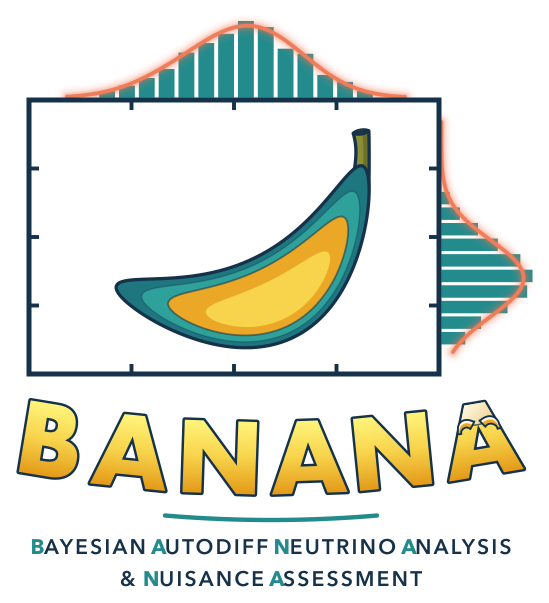
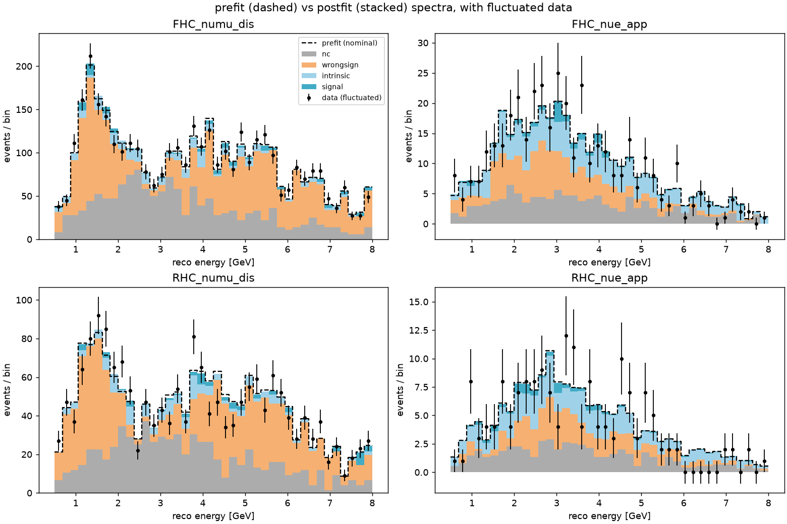
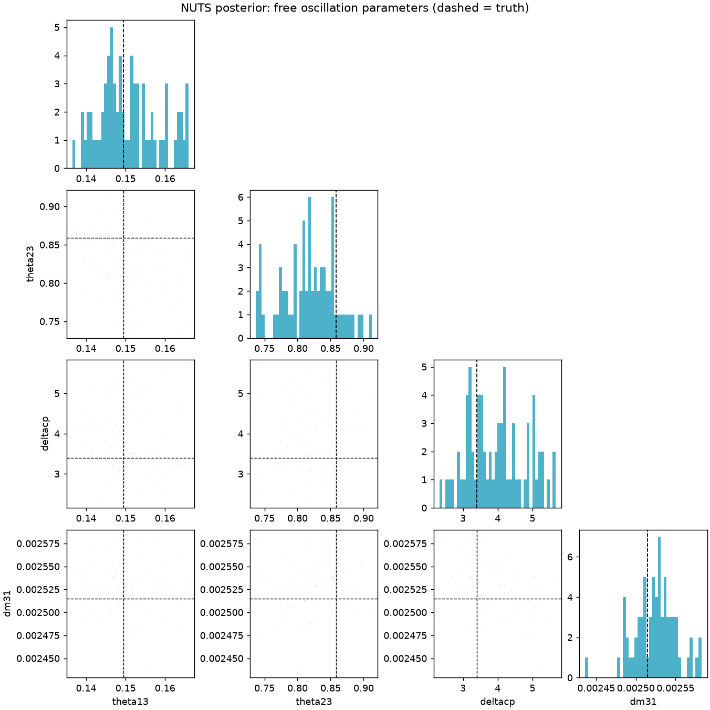
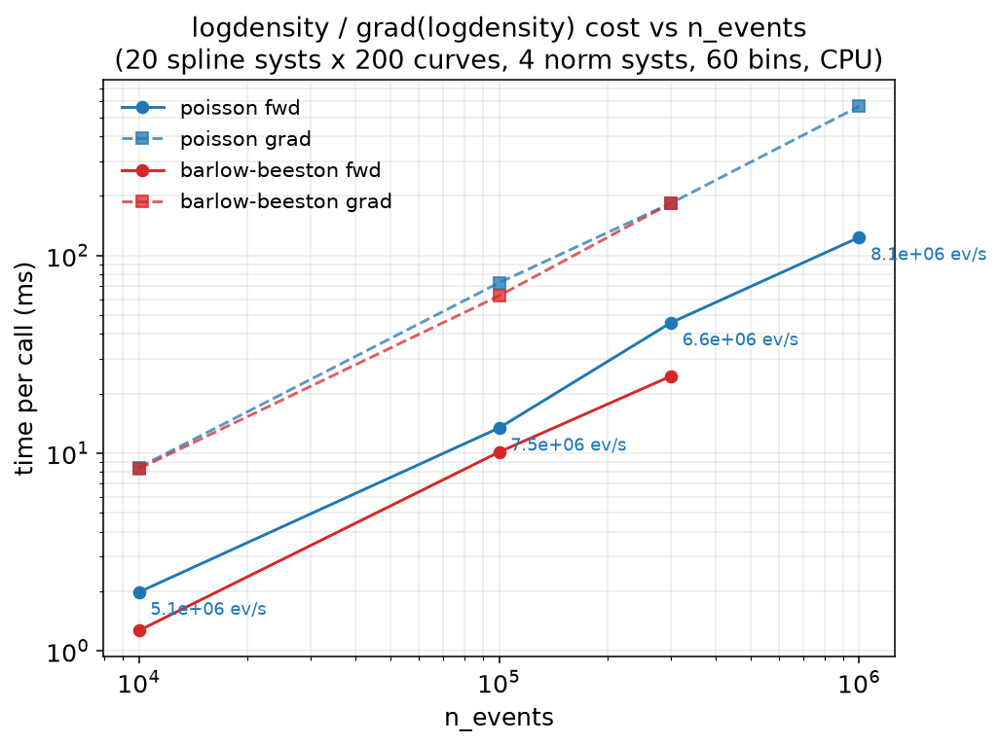
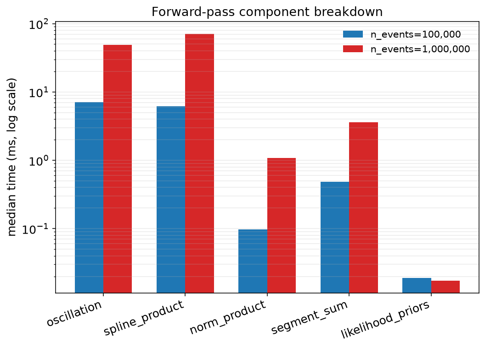

<p align="center">
  <picture>
    <source media="(prefers-color-scheme: dark)" srcset="assets/banana_logo_dark.svg">
    
  </picture>
</p>

<h1 align="center">BANANA</h1>
<h3 align="center">Bayesian Autodiff Neutrino Analysis &amp; Nuisance Assessment</h3>

<p align="center">
  <a href="https://github.com/pgranger23/banana-fit/actions/workflows/ci.yml"></a>
  <a href="LICENSE"></a>
</p>

**A differentiable MCMC oscillation fitter in [JAX](https://docs.jax.dev), built on
[MANGO](https://github.com/pgranger23/mango-osc).** The Python package is `bananafit`.

`bananafit` takes an event-level MC sample (reconstructed energy, true energy,
flavor) plus spline-based systematic responses (event weight vs. σ-variation
of each systematic) and turns them into a binned likelihood you can fit two
ways from the *same* posterior: gradient-based MCMC (NUTS/HMC/MALA, exploiting
MANGO's exact oscillation gradients) or classic adaptive random-walk
Metropolis (MaCh3-style). One jitted `logdensity(z) -> scalar` function is the
whole hot path; everything upstream of it — spline coefficients, bin indices,
parameter transforms — is precomputed once at build time.

Conceptually this covers the same ground as
[MaCh3](https://github.com/mach3-software/MaCh3): a spline monolith of
systematic responses, normalization parameters, Poisson and
Barlow-Beeston-lite test statistics, correlated covariance priors, adaptive
RWM. It is organised as plain functions: every object is a frozen dataclass
pytree or a pure function, and the whole analysis is composed at the top by
about ten lines of user code (see [Quick start](#quick-start)).

[MANGO](https://github.com/pgranger23/mango-osc) (the differentiable oscillation-probability engine, `jaxnu` on PyPI)
does the oscillation physics; BANANA is the fitting layer built on top of it.

---

## Why differentiable

The established fast fitters (MaCh3, GLoBES-based χ² scans) evaluate a
likelihood; they don't hand you its gradient. `bananafit` gets exact gradients
of the full binned posterior — oscillation probabilities, spline systematics,
normalizations, Poisson/BB-lite likelihood, priors, parameter-transform
Jacobian — for free from `jax.grad`, because every piece of the forward model
is written in JAX. That gradient is what NUTS/HMC use to take informed steps
instead of a random walk, and it costs measured **≈4–5× a forward
evaluation** end-to-end (Poisson rows, 10⁴–10⁶ events: 4.0–5.4×;
`benchmarks/RESULTS.md` item 1) — the same few-× range as MANGO's own
oscillation-kernel gradient cost, so the spline/norm/binning machinery on top
does not add a disproportionate tax.

What the gradients are used for: MAP and profiled fits (L-BFGS), Laplace
covariances and Hessians, and NUTS. A gradient sampler is not automatically
faster: a random walk with a Hessian (Laplace) proposal and an octant hop is a
strong baseline, and which one wins depends on the posterior. NUTS warmup with
`blackjax.window_adaptation` is slow on poorly-conditioned models (5.85 s per
warmup step at 20,000 events, [Performance](#performance));
`laplace_seeded_nuts` skips the online mass-matrix estimation by seeding it
from a MAP + Laplace covariance, dual-averaging only the step size. The
practical recipe: MAP fit → Laplace covariance → seeded NUTS or
Laplace-proposal RWM (`algorithm="rwm"`), both built in. (The toy
NUTS-vs-RWM ranking in `benchmarks/NUTS_TUNING.md` is withdrawn: its RWM ran
at acceptance 0.69–0.75 with 15–250-sample chains; see the note at its top.)

At full scale the toy points the same way
([`examples/LARGE_FIT_REPORT.md`](examples/LARGE_FIT_REPORT.md): 400,000
events, 4 samples, 17 free parameters — all recovered within 1σ of Asimov
truth): naive step-size adaptation develops a stiff-direction pathology
(runaway tree depths, 45% divergences) that the `max_num_doublings` cap and
a lower `target_acceptance_rate` tame (3% divergences, bounded cost), but a
well-tuned Laplace-proposal RWM still delivers ~2× the ESS/s of NUTS there
on CPU. Both sampler families share one driver and one tuned proposal
source, so switching between them is a one-argument change — use whichever
wins for your posterior, and re-measure when moving to GPU.

---

## Install

```bash
git clone https://github.com/pgranger23/banana-fit
cd banana-fit
pip install -e .            # core: jax, numpy, scipy, jaxnu (MANGO), blackjax, numpyro, h5py
pip install -e ".[report]"  # + arviz, matplotlib (diagnostics/plots/examples)
pip install -e ".[extras]"  # + jax-tqdm, optax (progress bars, MAP pre-fit)
pip install -e ".[root]"    # + uproot (ROOT TSpline3 import, bananafit.root_import)
pip install -e ".[test]"    # + pytest
```

Requires Python ≥ 3.12 (CI tests 3.12 and 3.13) and [MANGO](https://github.com/pgranger23/mango-osc)
(`jaxnu>=0.2` on PyPI, installed as a dependency). Float64 is mandatory for oscillation phases and is enabled
automatically on `import bananafit`, exactly as in MANGO.

---

## Quick start

```python
import dataclasses
import jax

import bananafit
from bananafit import (
    make_dune_like_analysis, build_forward_model, make_posterior,
    asimov_data, poisson_fluctuate, Gaussian, VonMises, ParameterSet,
)
from bananafit.sampling import laplace_seeded_nuts

# 1. A self-contained 4-sample DUNE-like toy analysis: FHC/RHC x
#    numu-disappearance/nue-appearance, with spline + norm systematics
#    already wired up (bananafit.toy is a full worked example of the
#    builder API in model.py/events.py/splines.py/norms.py). Kept small
#    here so the whole snippet runs in a couple of minutes on CPU --
#    examples/dune_toy_fit.py runs the DUNE-ballpark-scale version.
samples, parameter_set, truth = make_dune_like_analysis(
    n_events_per_sample=500, n_spline_systs=2, n_norm_systs=1, seed=0,
)

# 2. Fix the solar parameters and add a reactor theta13 prior, as any real
#    long-baseline fit would -- also keeps NUTS numerically well-behaved
#    (see "Validation" below). deltacp is `circular=True` (sampled
#    unbounded, identity transform), so its regularizing prior uses
#    VonMises (periodic) rather than Gaussian: same ~1.5 rad effective
#    width (kappa = 1/sigma**2), but physically equivalent under deltacp's
#    2*pi wrap-around, unlike a plain Gaussian.
specs = []
for spec in parameter_set.specs:
    if spec.name in ("theta12", "dm21"):
        specs.append(dataclasses.replace(spec, fixed=True))
    elif spec.name == "theta13":
        specs.append(dataclasses.replace(spec, prior=Gaussian(spec.init, 0.0075)))
    elif spec.name == "deltacp":
        specs.append(dataclasses.replace(spec, prior=VonMises(spec.init, 1 / 1.5**2)))
    else:
        specs.append(spec)
parameter_set = ParameterSet(tuple(specs))

model = build_forward_model(samples, parameter_set)

# 3. Asimov (noise-free) prediction at truth, Poisson-fluctuated into a
#    "measured" dataset, and the one posterior everything else fits.
data = poisson_fluctuate(asimov_data(model, parameter_set, overrides=truth), seed=1)
posterior = make_posterior(model, data, parameter_set, stat="poisson")

# 4. MAP -> Laplace covariance -> Laplace-seeded NUTS, in one call.
run, info = laplace_seeded_nuts(
    posterior.logdensity, posterior.z0,
    n_chains=2, n_warmup=15, n_samples=15, seed=0,
    map_kwargs=dict(n_steps=100),
)
print(f"MAP: {info['map_time_s']:.1f}s  Laplace Hessian: {info['laplace_time_s']:.1f}s")
bananafit.summary(run, names=parameter_set.free_names)   # mean/std/rhat/ess table

idata = bananafit.to_arviz(run, parameter_set=parameter_set)  # for corner/trace plots
```

This exact snippet was run end-to-end on this machine (CPU): MAP fit in
22 s, the one-time Laplace Hessian in 56 s, and 2×30 total NUTS steps giving
sane per-parameter R-hat (~0.97–1.05) and ESS (~14–44). `n_warmup`/`n_samples`
here are deliberately tiny for a fast demo — `examples/dune_toy_fit.py` runs
the DUNE-ballpark-scale version (MAP, Laplace, NUTS *and* RWM, four saved
figures, an HDF5 round-trip demo): `--quick` for a ~5–6 minute smoke run, no
flag for the full multi-chain fit (tens of minutes on CPU).

---

## Architecture

```
bananafit/
  __init__.py      x64 enforcement + public re-exports
  events.py        EventSample struct-of-arrays pytree
  splines.py       spline coefficient tables + Horner eval
  norms.py         normalization systematics (masked multiplicative weights)
  shifts.py        FD reconstructed-energy shift systematics + differentiable binning
  parameters.py    ParamSpec/ParameterSet, transforms, priors
  oscillation.py   per-event oscillation weights via jaxnu
  model.py         ForwardModel: weights -> binned prediction
  likelihood.py    binned test statistics (Poisson, Barlow-Beeston-lite)
  posterior.py     logdensity assembly
  sampling.py      blackjax drivers, multi-chain, adaptation
  diagnostics.py   R-hat/ESS, arviz conversion, summaries
  io.py            HDF5 read/write of samples + splines
  root_import.py   ROOT TSpline3 import: MaCh3/T2K/DUNE spline-monolith compatibility
  globes_bridge.py bridge from jaxnu.globes.GlobesExperiment to bananafit SampleModels
  toy.py           toy MC generator (DUNE-like)
```

The one function this whole package exists to differentiate is
`BinnedPosterior.logdensity(z)`: unconstrain `z` to physical parameters,
compute the binned prediction (`ForwardModel.expected`), evaluate the
likelihood, add the prior and the change-of-variables Jacobian. It closes
over everything static — event arrays, spline coefficients, bin indices —
so `jax.jit`/`jax.grad`/a blackjax kernel trace exactly the array math and
nothing else. Caveat: XLA embeds closed-over arrays as constants in every
compiled executable. For a multi-GB per-event table (2.8 GB of constants
in one case) that ran a V100 out of memory; pass such a table to `jit` as an
argument instead.

Two design choices do most of the work of keeping that hot path fast:
**precompute at build time, evaluate flat at run time** (spline coefficients,
event→curve indices, and per-sample parameter-index arrays are all baked into
plain arrays when `build_forward_model` runs — the per-step cost is
gather → Horner → product → `segment_sum`, no Python control flow on traced
values), and **`anti_split` as a static, presorted boundary**: events are
sorted neutrino-then-antineutrino at build time, so `oscillation.py` makes
exactly two `jaxnu.probability_constant` calls on contiguous, statically-shaped
slices per sample instead of a per-event dynamic dispatch.

---

## Systematics model

**Splines** (`splines.py`) are the JAX-native analogue of MaCh3's spline
monolith: a systematic's response is a cubic spline through σ-knots giving a
multiplicative per-event weight. Two structural facts are exploited:

1. The evaluation point (a systematic's current MCMC value, in σ) is the
   *same scalar for every event*, so finding the active spline segment is one
   `searchsorted` per systematic, not one per event.
2. Response curves are shared across many events (built per mode × kinematic
   bin, not per event) — a `(n_syst, N)` integer index array dedups curves,
   with curve `0` always the identity (`w=1`) response.

Coefficients are built once with `scipy.interpolate.CubicSpline` (natural
boundary conditions by default, i.e. ROOT `TSpline3` with explicit `"b2e2"`;
`boundary="not-a-knot"` gives ROOT's default coefficients, DESIGN.md §11.1) and stored in
Horner form, by default as **float32** (weights are O(1) smooth factors;
memory is the binding constraint at ~10⁶ events × ~50 systematics) — the
per-event product that consumes them always accumulates in float64.

The measured dedup payoff (`benchmarks/RESULTS.md` item 4,
`fig4_dedup_payoff.png` below) is **mostly a build-time and memory effect, not
an eval-time one**: at 1 systematic and 100,000 events, building without dedup
(100,000 per-event curves) is ~520× slower than deduped (200 curves) — 33.6 s
vs 65 ms — and uses ~24× the memory, but the jitted `SplineTable.__call__`'s
vmapped Horner pass is only ~1.2× slower for the no-dedup case (0.255 ms vs
0.222 ms; 1.2–4.3× across three replicate runs — the least stable number in
that benchmark): XLA vectorizes the per-curve evaluation efficiently enough
that per-*step* MCMC cost barely notices at this scale.

**Norms** (`norms.py`) are a 1-knot spline's cheap special case: a masked
affine map, `w[i] = prod_n (1 + (x_n - 1) * mask[n, i])`, no segment search or
coefficient gather. **Functional systematics** (anything not expressible as a
spline or norm) are a plain callable hook at the `SampleModel` level —
`extra_weight(sys_physical_by_name, events) -> (N,) weights` — no framework
required.

---

## Likelihoods

Both are pure functions on `(mu, w2, data)` returning **log-likelihood** (not
χ²; MCMC wants a smooth scalar to differentiate), with the jaxnu
double-`where` idiom guarding every `sqrt`/`log`/division so reverse-mode AD
never sees a NaN gradient at a domain edge.

- **Poisson**: `sum_b n_b log(mu_b) - mu_b` (`log(n_b!)` dropped, an
  n-only constant), `mu` floored inside the log only (MaCh3's low-MC-statistics
  floor).
- **Barlow-Beeston-lite** (Conway, arXiv:1103.0354; equivalent to pyhf's
  `staterror` and MaCh3's `GetTestStatLLH`): one nuisance scale β per bin
  absorbing the MC's own finite-statistics uncertainty (`w2`, the sum of
  squared event weights per bin, flows through `ForwardModel.expected`
  alongside `mu`), profiled out in closed form from
  `β² + (μσ²−1)β − nσ² = 0` with `σ² = w2/μ²`: Poisson in `βμ` plus a
  Gaussian penalty on `β`.

---

## Samplers

One `run_mcmc(logdensity, init, algorithm=..., ...)` contract wraps four
`blackjax` kernels, vmapped over chains:

| algorithm | gradient? | proposal | notes |
|---|---|---|---|
| `nuts` | yes | dynamic trajectory (No-U-Turn) | API default; the beam production chains use `rwm` (see [Why differentiable](#why-differentiable)) |
| `hmc` | yes | fixed-length trajectory | `num_integration_steps` configurable |
| `mala` | yes | one Langevin step | own step-size-only warmup (no mass matrix by construction) |
| `rwm` | no | correlated Gaussian, `additive_step_random_walk` | MaCh3 parity; needs `proposal_cov` |

Warmup modes for the gradient-based kernels (`warmup=`):

- `"window"` (default) — `blackjax.window_adaptation`, online mass-matrix
  estimation + step-size dual averaging. Cold-start safe, but its
  mass-matrix estimation is the dominant cost on poorly-conditioned models
  (see [Why differentiable](#why-differentiable)).
- `"step-size"` — mass matrix fixed (typically from `laplace_covariance`),
  only the step size is dual-averaged. Never slower to warm up than
  `"window"`, and the recipe behind `laplace_seeded_nuts`.
- `"none"` — no adaptation; both step size and mass matrix must be supplied.

`laplace_seeded_nuts(logdensity, z0, ...)` chains `map_fit` → `laplace_covariance`
→ `run_mcmc(warmup="step-size")` (or `algorithm="rwm"` with the same
covariance as `proposal_cov`) in one call. `map_fit` is L-BFGS via `optax`;
`laplace_covariance` is `inv(-hessian(logdensity))` at the mode (falls back to
a pseudo-inverse off a `RuntimeWarning` if the Hessian isn't PD there).

`diagnostics.py` wraps `blackjax.diagnostics` for R-hat/ESS
(`chain_axis=0, sample_axis=1`, matching `MCMCRun.positions`'s
`(n_chains, n_samples, n_free)` layout) and `to_arviz(run, parameter_set=...)`
converts a run to an `arviz.InferenceData` in physical space (circular
parameters wrapped, correct names) for corner/trace plots and NetCDF
persistence.

---

## Validation

The test suite in `tests/` covers every module. The end-to-end ladder
(`tests/test_endtoend.py`) runs on a small 2-sample (FHC-only), 8-free-parameter DUNE-like toy — with a
reactor-precision θ₁₃ prior and a wide regularizing δ_CP prior (`VonMises`,
periodic — physically equivalent under δ_CP's 2π wrap-around, unlike a plain
Gaussian), exactly like a real long-baseline analysis (and load-bearing for
sampler stability: with
plain flat priors on both, early-warmup NUTS trajectories wander into the
θ₁₃–δ_CP degeneracy and produce ~100% divergent transitions):

1. **MAP recovers truth.** Asimov closure: L-BFGS from a displaced start
   converges to the injected truth point to within its per-parameter
   optimizer tolerance (~10⁻³ for the angles, 10⁻⁶ for `dm31`).
2. **NUTS recovers truth.** The full posterior's truth point sits within
   **0.92σ** of the NUTS posterior mean, worst-case over the 8 free
   parameters, with R-hat < 1.05 for all of them.
3. **Laplace vs. NUTS agree.** The MAP+Hessian Laplace-approximated posterior
   width and the NUTS posterior's empirical width agree to **21%**, worst
   case — expected in the near-Gaussian Asimov regime.
4. **NUTS vs. RWM agree**, and run cleanly: with the reactor/regularizing
   priors in place, NUTS reports **zero divergent transitions** (vs.
   ~100% with flat priors) and its posterior means agree with RWM's to
   within their combined MC error.

A second check builds a model from DUNE's public TDR GLoBES configuration
(shipped with MANGO): `tests/test_globes_bridge.py` reproduces MANGO's
GLoBES-style spectra exactly through `bananafit.globes_bridge`, rebins them
exactly to an analysis binning, and checks gradients through the bridge
against finite differences. CI runs it against a pinned MANGO checkout.



*Stacked postfit component spectra (signal/wrongsign/intrinsic/NC) against
Poisson-fluctuated data, all four samples of `examples/dune_toy_fit.py --quick`
(the ~2,500-events-per-sample smoke-test scale, 2 chains x 35 NUTS draws -- NOT
the full run), produced by `ForwardModel.event_weights` + `numpy.bincount` as an
independent cross-check of `ForwardModel.expected`'s own `segment_sum`. The
400,000-event version (Asimov data, so the closure is trivially expected) is
`examples/figures/large/spectra_prefit_postfit.png`.*



*NUTS posterior over the four free oscillation parameters (dashed = truth),
hand-rolled corner plot from `run.positions` via `parameter_set.constrain`
-- again the `--quick` smoke run (2 x 35 draws), so the histograms are jagged and
only indicative. The converged 400,000-event posterior (long RWM chain, 4 x 80,000
draws) is `examples/figures/large/corner_osc_params_rwm10x.png`.*

---

## Performance

CPU-only, float64, full-scale run of `bench_hotpath.py` (`benchmarks/RESULTS.md`;
Slurm job on a CC-IN2P3 Lyon htc node, 4 XLA threads — a second local run on a
heavily loaded dev box is in `benchmarks/RESULTS_local_loaded_run.md`, and the
noise between replicates is tabulated at the end of `RESULTS.md`). 20 spline
systematics × 200 dedup curves, 4 norm systematics, 60 bins, single sample,
Poisson likelihood:

| n_events | fwd (ms) | grad (ms) | grad/fwd | events/s (fwd) |
|---|---|---|---|---|
| 10,000 | 1.98 | 8.4 | 4.3 | 5.1M |
| 100,000 | 13.4 | 72.7 | 5.4 | 7.5M |
| 300,000 | 45.6 | 183.6 | 4.0 | 6.6M |
| 1,000,000 | 123.4 | 567.8 | 4.6 | 8.1M |



Forward cost grows roughly linearly in events (≈ 5–8M events/s). The forward pass is
split roughly evenly between **oscillation** (`jaxnu`'s `nufast` kernel, real
per-event trig: 48 ms at 10⁶ events) and the **spline product** (per-event
gathers: 71 ms at 10⁶ events; at 10⁵ events oscillation 7.1 ms vs splines
6.1 ms) — the spline product is *not* negligible next to oscillation, contrary
to DESIGN.md's expectation, once N is large — while norms, histogramming and priors are
a few percent:



**The honest CPU story:** a single `logdensity`+`grad` pair costs ≈ 86 ms at
10⁵ events and ≈ 0.7 s at 10⁶, so gradient evaluation itself scales fine.
**NUTS's `window_adaptation` warmup does not** — a full `run_mcmc` call at
20,000 events measured **5.85 s/warmup-step**, i.e. a production NUTS fit
(hundreds to thousands of warmup steps) at DUNE-scale event counts
(10⁵–10⁶) should be budgeted in CPU-hours with default settings, not
minutes. Two mitigations, both measured above: reduce the warmup cost
directly with `laplace_seeded_nuts` (`warmup="step-size"` skips online
mass-matrix estimation entirely), or fall back to RWM, which is
usable to ~10⁶ events (one forward pass per step, no gradient: 13 ms at 10⁵
events, 123 ms at 10⁶); note that vmapping RWM chains on CPU raises total
throughput only modestly (87 → 146 steps/s for 1 → 8 chains at 10⁵ events,
`RESULTS.md` item 6), i.e. per-chain throughput falls almost as 1/n_chains.

**GPU.** Every hot-path op — oscillation, spline Horner, norm product,
`segment_sum`, Poisson/BB-lite reduction — is dense, branch-free, and
embarrassingly parallel over the event axis, so the forward pass maps well
onto a GPU, and many chains can be vmapped in one device call. This
benchmark is CPU-only.

The Laplace-seeded-NUTS-vs-RWM comparison in `benchmarks/NUTS_TUNING.md` is
withdrawn: its RWM ran at acceptance 0.69–0.75 with 15–250-sample chains, so
its ESS/s ranking is not a result.

---

## Limitations & roadmap

From `DESIGN.md` §13 (deliberate v1 non-goals):

- **Atmospheric (zenith-binned) oscillation weighting** — not in the
  package: the `OscConfig` interface is reserved for it, `oscillation.py`
  ships `ConstantMatterOsc`/`VacuumOsc` (long-baseline only), and `EarthOsc`
  still raises `NotImplementedError`. It can be done outside the package with
  MANGO (PREM layers, production-height averaging, sub-sampling as in
  NuOscillator) and passed in as per-event weights.
- **ROOT `TSpline3` import** (now implemented, no longer a non-goal) —
  `root_import.py` reads the knots of MaCh3/T2K/DUNE `TSpline3` files via
  `uproot` (`read_tspline3_knots`, `spline_table_from_root`; install the `root`
  extra) and builds a `SplineTable` from them, refitting the coefficients
  locally rather than trusting the file's own. It is one-directional
  (`uproot` cannot write `TSpline3`); `io.py`'s HDF5 schema remains the
  native spline format (DESIGN.md §11.1).
- **PCA of the systematic space**, **multi-device sharding**, **simulated
  annealing** — none implemented.
- **Mass-ordering jumps** — not in `bananafit/sampling.py` (run NO/IO as two
  chains and Bayes-factor them instead). Guarded ordering and octant
  translation jumps can be built by the caller and passed to `run_mcmc` as
  `hop_move_fn` moves.
- **NUTS warmup on poorly-conditioned models** — see
  [Performance](#performance); `laplace_seeded_nuts` is the current
  mitigation, not a full fix (a well-conditioned reparametrization is the
  next step; the `max_num_doublings` / `target_acceptance_rate` knobs are
  already exposed on `run_mcmc`, see `examples/LARGE_FIT_REPORT.md`'s "NUTS fix").

## License

MIT.

If you use the oscillation physics underneath this package, please also cite
MANGO (arXiv:2608.13429, [MANGO](https://github.com/pgranger23/mango-osc)) and, if you use its `nufast` backend,
Denton & Parke 2024, arXiv:2405.02400 (see MANGO's README for the full
citation).
