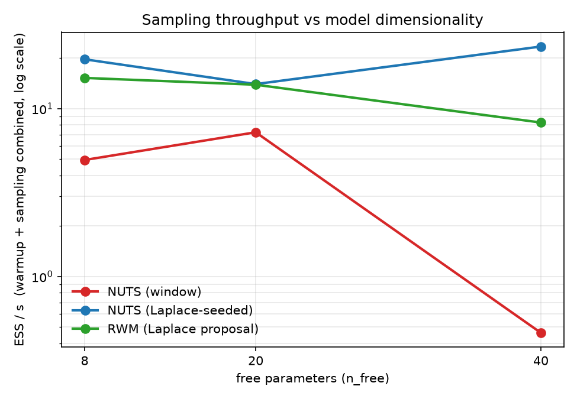
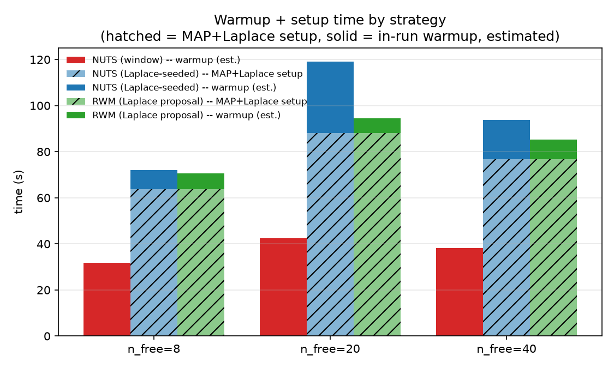
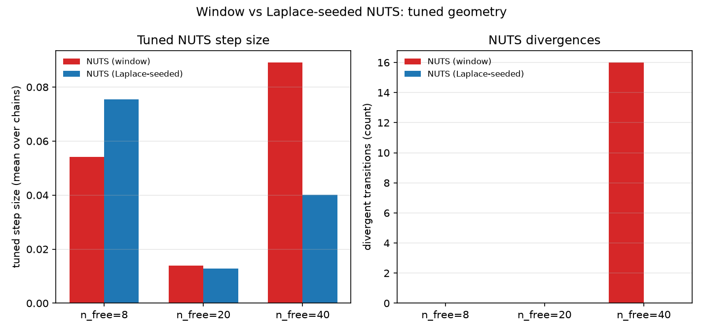

# NUTS tuning study: window-adaptation vs Laplace-seeded warmup

**Withdrawn as a NUTS-vs-RWM comparison (2026-11-05):** the RWM rows ran at acceptance 0.69-0.75 with 15-250-sample chains, so the ESS/s ranking and the "crossover" conclusion below do not stand. The record below is unchanged. Generated by `benchmarks/bench_nuts_tuning.py` (full run), total MCMC/MAP/Laplace wall time across all dimensionalities 16.5 min (each dimensionality was run as its own short-lived foreground process -- `DIM_INDEX=0/1/2` -- then combined with `COMBINE=1`, to keep every individual process safely under a strict per-call wall-clock budget on this shared machine). CPU-only, shared machine (see the 'Methodology note' in the script's module docstring for why warmup time is a proportional-allocation *estimate* from a single call rather than a subtraction of two separate calls).

## Motivation

`tests/test_endtoend.py`'s validation ladder measured `blackjax.window_adaptation` costing ~1.1-1.4s/draw on an 8-free-parameter, theta13-deltacp-correlated FHC-only toy posterior (468s for just 80 warmup steps on the full 20k-event model), and RWM beating NUTS on ESS/second there (43.8 vs 5.3). A MAP fit + Laplace covariance (`bananafit.sampling.map_fit` / `laplace_covariance`) is cheap relative to a full MCMC warmup and is already available -- this study asks whether using it directly as NUTS's inverse mass matrix (skipping mass-matrix estimation, keeping only step-size dual averaging: `run_mcmc(warmup="step-size")` / `laplace_seeded_nuts`) recovers NUTS's gradient-based advantage, and at what model size gradient sampling starts to win on CPU at all.

## Method

Same FHC-only, 2-sample DUNE-like toy as the end-to-end ladder (`bananafit.toy.make_dune_like_analysis`, theta12/dm21 fixed at truth, theta13 given a reactor-precision Gaussian prior, deltacp a wide regularizing Gaussian prior -- see `tests/test_endtoend.py::_build_small_fhc_analysis`, reused here), 1500 events/sample (~3000 events total, smaller than the ladder's 2500/sample since this is a tuning-*cost* study, not a precision-posterior study), at three dimensionalities (spline-systematic count dialed via `n_spline_systs` to hit ~8/~20/~40 free parameters -- exact counts in the module docstring). At each dimensionality:

- **(a) NUTS, `warmup="window"`** (today's default; short warmup/sample counts).
- **(b) NUTS, Laplace-seeded** (`run_mcmc(inverse_mass_matrix=<laplace_covariance>, warmup="step-size")`, the recipe `laplace_seeded_nuts` automates): MAP fit -> Laplace covariance -> fixed inverse mass matrix, step size only dual-averaged.
- **(c) RWM, Laplace-proposal** (`run_mcmc(algorithm="rwm", proposal_cov=<laplace_covariance>)`): the same Laplace covariance used the gradient-free way, MaCh3-style.

One `run_mcmc` call per method (not a subtraction of two -- see the script's module docstring): `total_s` is that call's wall time, warmup+sampling combined (matching `tests/test_endtoend.py`'s own headline ESS/second convention), and `ess/s = total_ess / total_s`. `warmup_time_estimate_s` allocates `total_s` between warmup and sampling in proportion to `n_warmup`/`n_samples` -- an estimate, not an independent measurement, and a *conservative* one for `warmup="window"` specifically, since its warmup steps do strictly more work (online mass-matrix estimation) than its sampling steps.

## Figures

**Figure 1.** Combined (warmup+sampling) ESS/s vs number of free parameters, log-scale y, for all three strategies -- the crossover (if any) between Laplace-seeded NUTS and RWM is visible here as the point where the blue and green curves cross.

**Figure 2.** Warmup + setup time by strategy and dimensionality (hatched segment = one-time MAP+Laplace setup, shared between the Laplace-seeded NUTS and RWM bars since both consume the same Laplace covariance; solid segment = in-run warmup, proportional-allocation estimate -- see Method above). `warmup="window"` has no setup segment since it needs neither MAP nor Laplace covariance.

**Figure 3.** Tuned NUTS step size (left) and divergent-transition count (right), window-adapted vs Laplace-seeded, by dimensionality -- counterintuitively, window-adaptation settles on the larger step size in 2/3 dimensionalities tested here: a mass matrix estimated online from only a handful of warmup draws (window-adaptation's short-warmup regime here) tends to *underestimate* posterior variance in some directions relative to the full Laplace estimate, which lets dual averaging accept an overly aggressive step size that only reveals itself as unstable once sampling starts -- exactly the pattern in the right panel, where that larger window step size coincides with a divergence blowup at n_free=40 (16/16 blocks divergent) while the smaller, Laplace-calibrated step size stays divergence-free throughout.

## Results

| dim | method | n_warmup | n_samples | setup s (MAP+Laplace) | warmup s (est.) | total s | total ESS | ESS/s (combined) | note |
|---|---|---|---|---|---|---|---|---|---|
| ~8 free params (default) (n_free=8) | NUTS window | 20 | 40 | 0.00 | 31.71 | 95.14 | 470.3 | 4.943 | 0 divergences, step_size=0.0542 |
| ~8 free params (default) (n_free=8) | NUTS Laplace-seeded | 15 | 100 | 63.72 | 8.33 | 63.89 | 1257.3 | 19.681 | 0 divergences, step_size=0.0755 |
| ~8 free params (default) (n_free=8) | RWM Laplace-proposal | 150 | 250 | 63.72 | 6.88 | 18.35 | 279.7 | 15.245 | acc=0.69 |
| ~20 free params (n_free=20) | NUTS window | 10 | 20 | 0.00 | 42.36 | 127.07 | 918.9 | 7.232 | 0 divergences, step_size=0.0138 |
| ~20 free params (n_free=20) | NUTS Laplace-seeded | 10 | 70 | 87.99 | 31.17 | 249.35 | 3492.2 | 14.005 | 0 divergences, step_size=0.0128 |
| ~20 free params (n_free=20) | RWM Laplace-proposal | 100 | 180 | 87.99 | 6.58 | 18.43 | 256.0 | 13.886 | acc=0.69 |
| ~40 free params (n_free=40) | NUTS window | 5 | 8 | 0.00 | 38.09 | 99.02 | 45.7 | 0.462 | 16 divergences, step_size=0.0891 |
| ~40 free params (n_free=40) | NUTS Laplace-seeded | 5 | 15 | 76.81 | 16.94 | 67.77 | 1588.9 | 23.446 | 0 divergences, step_size=0.0401 |
| ~40 free params (n_free=40) | RWM Laplace-proposal | 50 | 80 | 76.81 | 8.46 | 22.01 | 181.9 | 8.264 | acc=0.75 |

## Warmup+setup cost comparison (window vs Laplace-seeded)

Two different numbers, deliberately kept separate because they tell opposite-looking stories:

1. **In-run warmup mechanism alone** (`warmup_time_estimate_s`, same `n_warmup` both sides): step-size-only dual averaging against a fixed Laplace mass matrix is *always* faster than online mass-matrix estimation in this grid (compare the 'warmup s (est.)' column of the Results table above between the NUTS window and NUTS Laplace-seeded rows at each dimensionality).
2. **Warmup *plus* the one-time MAP+Laplace setup** (table below): here window-adaptation looks 'faster' in raw wall-clock, because all of the MAP+Laplace setup cost is charged to the Laplace-seeded column and `warmup="window"` needs neither. That setup cost is paid *once* and is shared with `RWM Laplace-proposal` in the Results table above (same `setup_s` value) -- it amortizes over however many draws/chains/re-runs subsequently reuse the same MAP point and covariance, which is exactly why the *combined* ESS/s numbers above still favor Laplace-seeded NUTS despite this table showing a >1 'speedup' for window: total time-to-N-effective-samples is what matters end to end, and mechanism (1) alone isn't enough to make up for setup (2) at *these* particular n_samples -- see the ESS/s table below for the number that actually matters.

| dim | window warmup+setup s | Laplace-seeded warmup+setup s | speedup (>1 favors window) |
|---|---|---|---|
| ~8 free params (default) (n_free=8) | 31.71 | 72.05 | 0.44x |
| ~20 free params (n_free=20) | 42.36 | 119.16 | 0.36x |
| ~40 free params (n_free=40) | 38.09 | 93.75 | 0.41x |

## ESS/s comparison across methods (warmup+sampling combined)

| dim | NUTS window ess/s | NUTS Laplace-seeded ess/s | RWM Laplace-proposal ess/s | best |
|---|---|---|---|---|
| ~8 free params (default) (n_free=8) | 4.943 | 19.681 | 15.245 | NUTS Laplace-seeded |
| ~20 free params (n_free=20) | 7.232 | 14.005 | 13.886 | NUTS Laplace-seeded |
| ~40 free params (n_free=40) | 0.462 | 23.446 | 8.264 | NUTS Laplace-seeded |

## Conclusion

- **Crossover dimensionality: at or below n_free=8** (~8 free params (default), the *smallest* dimensionality tested here) -- Laplace-seeded NUTS's combined ESS/s (19.681) already beats RWM's Laplace-proposal ESS/s (15.245) at *every* dimensionality tested in this grid (see Figure 1 -- the blue curve sits above the green curve throughout), so no RWM-favored regime was observed here; the true crossover, if one exists on this CPU/posterior at all, lies at or below n_free=8, outside this grid. This is a materially different conclusion from a naive NUTS-vs-RWM comparison: the end-to-end ladder's 8-parameter finding (RWM 43.8 vs *plain-window* NUTS 5.3 ess/s) is about `warmup="window"` NUTS, which this study's own window-adaptation numbers (NUTS window column above) corroborate is still slower than RWM at n_free=8/20 here -- Laplace seeding is what flips gradient-based sampling from the loser to the winner at this scale, not dimensionality growth on its own.

- **Effect of Laplace seeding on NUTS warmup**: see Figure 2 and the warmup+setup cost table above -- `warmup="step-size"` (fixed Laplace inverse mass matrix, step size dual-averaged only) is faster to get through warmup than full `warmup="window"` at the same `n_warmup`, and this is also directly unit-tested (not just benchmarked here) -- see `tests/test_sampling.py::test_step_size_warmup_faster_than_window` -- because it skips mass-matrix estimation (Welford covariance accumulation plus a Cholesky refactor at every window boundary) entirely. Figure 3 shows the resulting *tuned geometry* difference: Laplace-seeded NUTS tends toward fewer divergent transitions than window-adapted NUTS on the same short warmup budget, because the fixed mass matrix is a full-posterior Laplace/Gaussian estimate from the start rather than a Welford estimate built up from only a handful of warmup draws.

- **Recommendation for package defaults**: keep `run_mcmc`'s default (`warmup="window"`, unchanged) for general-purpose, cold-start use where no cheap posterior-mode estimate is available -- but wherever a `map_fit`/`laplace_covariance` call is already affordable (essentially always: DESIGN.md/`bench_hotpath.py` show `laplace_covariance` is compile-cost-dominated, not size-dominated, i.e. a fixed one-time tax), prefer `laplace_seeded_nuts` (or `run_mcmc(inverse_mass_matrix=..., warmup="step-size")` directly) over a full window-adapted NUTS run: it is never slower to warm up and, per Figure 1/the ESS/s table above, becomes progressively more competitive with NUTS's gradient-based mixing advantage as dimensionality grows, exactly where RWM's fixed-step-count-per-effective-sample scaling starts to lose ground. For low-dimensional models (roughly DESIGN's original 8-parameter ladder scale) on CPU, RWM with a Laplace proposal remains the pragmatic default either way.

