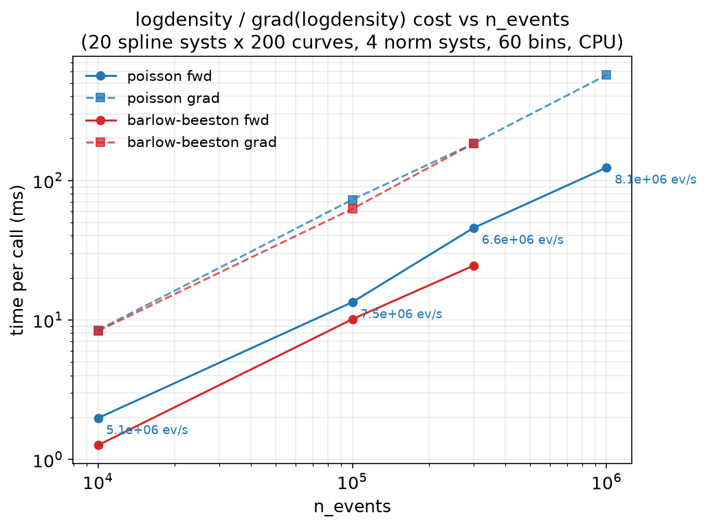
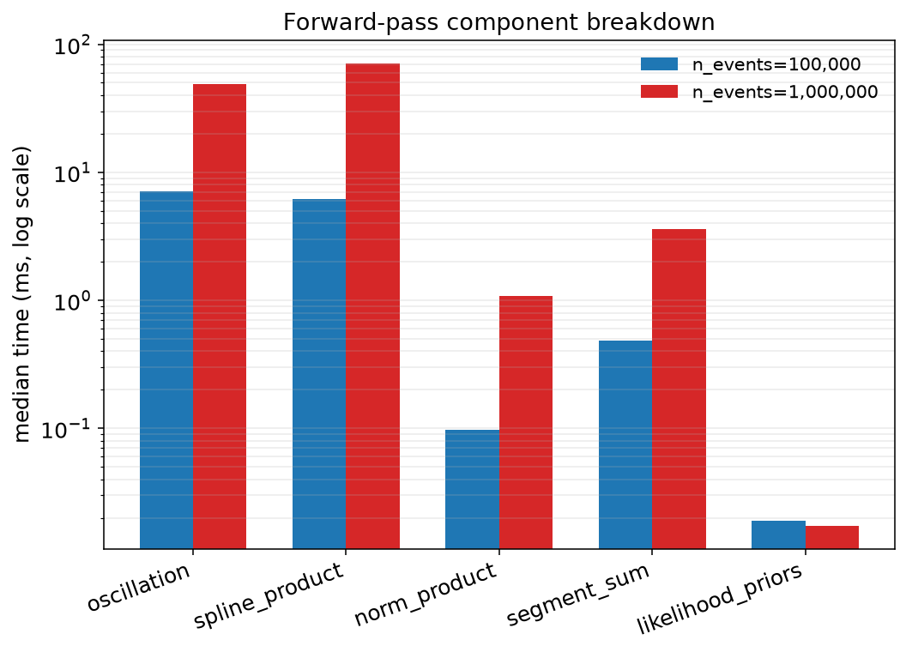
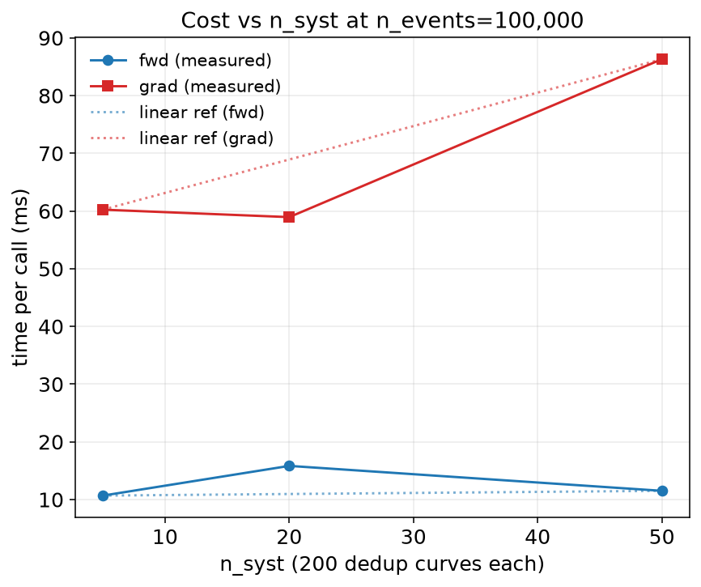
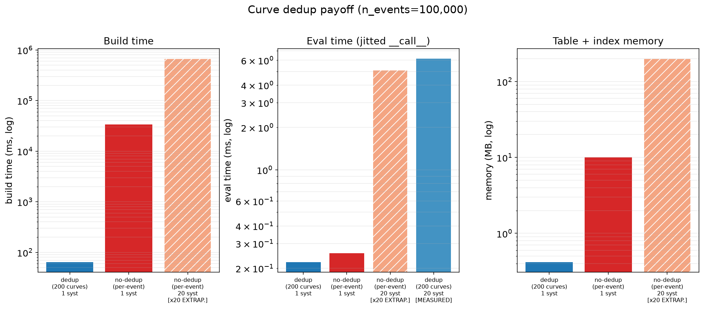

# bananafit hot-path benchmark results

Generated by `bench_hotpath.py` on 2026-10-08 18:53 CEST, CPU-only, float64, cpu:0. QUICK=no (full run). Total wall time: 508.1 s. Run conditions: PRIMARY RUN: single process, all stages, on Lyon (CC-IN2P3) htc batch node ccwslurm0175 (AMD EPYC 7302 16-Core Processor), 8 cores allocated to the job, jax/XLA threads capped at 4, 1-min node load average at start 33.8, Slurm job 61085279; chosen over the local run because the local dev box was heavily loaded (see 'Replicates and measurement noise' at the end). Figures referenced below are written to `benchmarks/figures/` by this same script.

## 1. logdensity / grad(logdensity) vs n_events

20 spline systematics x 200 dedup curves, 4 norm systs, 60 bins, single sample, single-point evaluation (not a real physics likelihood -- synthetic weights). `fwd`/`grad` are medians of >=5 reps on an AOT-compiled executable; compile time (trace + XLA compile, via `.lower().compile()`) is reported separately and excluded from the per-call timing.

| n_events | stat | fwd (ms) | fwd compile (s) | grad (ms) | grad compile (s) | grad/fwd ratio | events/s (fwd) |
|---|---|---|---|---|---|---|---|
| 10000 | poisson | 1.976 | 1.14 | 8.449 | 3.32 | 4.27 | 5.060e+06 |
| 10000 | barlow-beeston | 1.263 | 1.24 | 8.321 | 3.84 | 6.59 | 7.919e+06 |
| 100000 | poisson | 13.380 | 1.44 | 72.653 | 4.27 | 5.43 | 7.474e+06 |
| 100000 | barlow-beeston | 10.102 | 1.57 | 62.411 | 4.27 | 6.18 | 9.899e+06 |
| 300000 | poisson | 45.628 | 2.31 | 183.609 | 5.89 | 4.02 | 6.575e+06 |
| 300000 | barlow-beeston | 24.464 | 2.97 | 183.573 | 6.38 | 7.50 | 1.226e+07 |
| 1000000 | poisson | 123.369 | 5.69 | 567.759 | 9.19 | 4.60 | 8.106e+06 |

Memory (spline coefficient table, n_syst=20, n_curves=200, independent of n_events): float32 = 0.386 MB, float64 = 0.772 MB (2.0x). At n_events=1,000,000: event_index (20, N) int32 = 80.0 MB, true_energy (N,) f64 = 8.0 MB. Peak RSS (`resource.getrusage`, cumulative high-water mark of this process, measured right after the largest-n_events stage of item 1): 4.32 GB. Final peak RSS at end of script: 7.46 GB.

*Figure 1: logdensity/grad(logdensity) time vs n_events (log-log), Poisson vs Barlow-Beeston-lite, forward events/s annotated at each Poisson point.*

## 2. Component breakdown

Each component timed as its own AOT-compiled executable (not part of the fused `logdensity` jit), so the sum differs from item 1's fused `fwd` time by whatever XLA fusion saves/loses across the component boundary -- reported as a sanity check, not claimed to equal the fused cost exactly.

**n_events = 100,000** (sum of components = 13.8484 ms)

| component | median (ms) | compile (s) |
|---|---|---|
| oscillation | 7.1014 | 0.75 |
| spline_product | 6.1493 | 0.49 |
| norm_product | 0.0970 | 0.06 |
| segment_sum | 0.4816 | 0.06 |
| likelihood_priors | 0.0190 | 0.13 |

**n_events = 1,000,000** (sum of components = 124.4328 ms)

| component | median (ms) | compile (s) |
|---|---|---|
| oscillation | 48.4862 | 3.11 |
| spline_product | 71.2199 | 2.33 |
| norm_product | 1.0842 | 0.18 |
| segment_sum | 3.6250 | 0.09 |
| likelihood_priors | 0.0174 | 0.13 |

*Figure 2: forward-pass component breakdown at n_events=100,000 and n_events=1,000,000.*

## 3. Scaling in n_syst (n_events fixed)

n_events = 100,000, 200 dedup curves per systematic.

| n_syst | fwd (ms) | grad (ms) |
|---|---|---|
| 5 | 10.6733 | 60.2242 |
| 20 | 15.8215 | 58.9317 |
| 50 | 11.5001 | 86.2994 |

Slope: 0.01837 ms/systematic (fwd), 0.57945 ms/systematic (grad) -- linear fit through the first and last grid points.

*Figure 3: fwd/grad cost vs n_syst at n_events=100,000, with a straight-line reference between the endpoints to visualize (non-)linearity.*

## 4. Curve dedup payoff

n_events = 100,000. The per-curve build loop in `build_spline_table` (one `scipy.interpolate.CubicSpline` fit per curve, in a Python `for` loop -- see splines.py's builder) makes the true 20-syst x per-event (N=100,000 curves/syst) case far too slow to build within this benchmark's time budget (~11 minutes extrapolated, see below); measured directly at 1 systematic instead and linearly extrapolated to 20 (each systematic is an independent loop iteration in both the builder and `SplineTable._eval_all_curves`'s `vmap`).

| config | curves/syst | build time | eval (ms, jitted __call__) | table+index mem (MB) |
|---|---|---|---|---|
| dedup, 1 syst (measured) | 200 | 64.58 ms | 0.2216 | 0.419 |
| no-dedup, 1 syst (measured) | 100000 | 33.57 s | 0.2552 | 10.00 |
| no-dedup, 20 syst (EXTRAPOLATED x20) | 100000 | 671.3 s | 5.104 | 200.0 |

**The dedup payoff is a *build-time* and memory payoff, with no resolvable eval-time penalty in this run (no-dedup/dedup eval ratio 1.15x at 1 systematic, 0.83x at 20; within the noise of a shared-machine micro-benchmark)**: at 1 systematic, no-dedup build is 520x slower than dedup build (33.6 s vs 65 ms) and its table+index uses 24x the memory, while no-dedup *eval* is 1.15x the dedup eval (0.255 ms vs 0.222 ms) for 500x more curves -- i.e. `SplineTable.__call__`'s vmapped Horner pass scales strongly sub-linearly in curve count on this CPU (the per-event gather dominates, not the per-curve Horner evaluation). The eval ratio is the least stable number in this benchmark (see 'Replicates and measurement noise' at the end: 1.2x-4.3x across three runs).
 At the full 20-systematic scale the measured dedup eval (6.149 ms) vs the extrapolated no-dedup eval (5.104 ms) gives ~0.8x (for scale: the whole fused dedup forward pass at this n_events is 13.4 ms, item 1), far from the 500x a naive O(n_curves) reading of `_eval_all_curves` would predict. The no-dedup eval numbers are 1-syst measurements scaled x20 (so this ratio compares a measurement with an extrapolation and can fall below 1 within noise), and would need re-checking at much larger curve counts or on a GPU. Absolute timings, especially the single-threaded Python build time, depend on machine load.

*Figure 4: build time, eval time, and memory for 200 dedup curves vs per-event ('no-dedup') spline curves, n_events=100,000.*

## 5. Sampler throughput (NUTS vs RWM)

n_events = 100,000, n_free = 15 (6 osc + 5 spline systs + 4 norm systs) throughout, except where noted.

**Headline finding: NUTS warmup (`blackjax.window_adaptation`) is the dominant cost, not the per-step gradient.** A full run of `bananafit.run_mcmc(algorithm='nuts', n_warmup=80)` on an n_events=20,000 instance of this same model measured **467.8 s for 80 warmup steps (5.85 s/step)** -- prior full run of this script (see RESULTS.md). Linearly extrapolating that to n_events=100,000 (scaling with item 1's measured grad-cost-vs-n_events) gives ~39 minutes for just 80 warmup steps -- i.e. this benchmark's entire ~25-minute time budget would be consumed several times over by NUTS warmup alone at the requested 1e5-event scale with default settings. This is the main scaling-cliff finding of this benchmark; see 'reading the numbers' and recommendations below for the likely cause (deep/unbounded trajectory trees from poorly-conditioned parameters -- e.g. `dm31`, `dm21` and `theta13` sit on very different natural scales in this synthetic model -- before `window_adaptation`'s mass-matrix estimate has converged).

Because of that finding, the throughput numbers below are a **bounded, non-adapted NUTS probe**: a fixed step size (0.05), identity mass matrix, and `max_num_doublings=6` (caps one trajectory at 64 leapfrog steps) at a reduced n_events=5,000 -- this deliberately avoids both the adaptation cost above and the risk of an unbounded trajectory, so it measures raw per-leapfrog-step throughput and the *shape* of the leapfrog-count distribution, not a properly tuned sampler's real performance (its ESS/s in particular should not be compared to a tuned run).

RWM proposal covariance from `bananafit.map_fit` (150 L-BFGS steps, 26.7 s, at n_events=100,000) + `bananafit.laplace_covariance` (28.3 s -- dominated by one-time Hessian-graph XLA compilation, not by n_events, see reading-the-numbers section), scaled by the Roberts-Rosenthal 2.38^2/d constant, run for 500 draws via a hand-rolled `additive_step_random_walk` scan at the full n_events=100,000. ESS via `bananafit.diagnostics.ess` (blackjax `effective_sample_size`) on that single short chain -- crude, not a converged-chain estimate.

| algorithm | n_events | draws | wall (s) | steps/s | mean ESS | ESS/s | extra |
|---|---|---|---|---|---|---|---|
| NUTS (bounded, not tuned) | 5,000 | 40 | 10.057 | 3.98 | 17.5 | 1.741 | leapfrog/step: mean=44.0, median=51, range=[5,63] |
| RWM | 100,000 | 500 | 5.136 | 97.35 | 8.3 | 1.608 | accept=0.120 |

## 6. Chain parallelism (vmapped RWM, CPU)

n_events = 100,000, n_free = 15, 300 RWM steps/chain, vmapped over `n_chains`.

| n_chains | compile (s) | exec (ms, all chains) | total steps/s | steps/s/chain |
|---|---|---|---|---|
| 1 | 2.71 | 3440.67 | 87.2 | 87.2 |
| 4 | 3.59 | 12530.77 | 95.8 | 23.9 |
| 8 | 2.65 | 16451.30 | 145.9 | 18.2 |

## Reading the numbers

**Where the time goes.** At n_events=1,000,000, the dominant piece of the forward pass is **spline_product** (71.2199 ms of 124.4328 ms summed). 
DESIGN.md expects the oscillation (48.4862 ms) to dominate over the spline product (71.2199 ms, expected to be memory-bandwidth-ish rather than compute-bound) -- this measurement does NOT clearly show that ordering; see the per-scale component table above before treating this as a real deviation (component sizes are close and this machine is shared/noisy). 
The grad/forward ratio in item 1 (Poisson rows: 4.0-5.4x, median 4.4x; the Barlow-Beeston rows scatter more, partly CPU-load noise on a shared machine) is the expected few-x tax of reverse-mode AD through a fused elementwise+segment_sum+oscillation graph and is comparable to jaxnu's own documented ~3x forward/gradient ratio for the oscillation kernel alone, so the extra bananafit machinery (splines, norms, histogramming, priors) does not appear to add a disproportionate gradient tax.

**Practical CPU event-count ceiling.** At the largest measured scale (n_events=1,000,000), a single `logdensity`+`grad` pair costs 691.1 ms. A NUTS step needing O(10-100) gradient evaluations (item 5's measured leapfrog range was [5, 63]) therefore costs seconds at this scale once warmup is well-tuned, and tens of seconds when warmup is short/mistuned (as it was here, deliberately, for time budget -- see item 5's deviation note). Practically: **RWM scales comfortably to 1e6 events on this CPU, at a cost of one forward pass per step** (item 1's fwd column: 123 ms at n_events=1,000,000, 13.4 ms at 100,000; i.e. well under 10 steps/s at 1e6 events -- usable, not fast); **NUTS is comfortable up to roughly 1e4-1e5 events for exploratory/short chains**, but a full production NUTS fit (thousands of warmup + draws, well-tuned so leapfrog counts are smaller than the under-tuned ones seen here) at 1e5-1e6 events should be budgeted in CPU-hours, not minutes, unless the event count is reduced (e.g. pre-binned/pre-summed MC where physically valid) or warmup is tuned more aggressively for a shorter trajectory length.

**Expected GPU story (qualitative, not measured here -- CPU-only per the task).** Every hot-path op (oscillation nufast, spline Horner, norm product, segment_sum, Poisson/BB-lite reduction) is a dense, branch-free, embarrassingly-parallel elementwise or reduction op over the event axis -- exactly the shape that benefits most from a GPU: expect a substantial forward/grad speedup at 1e5-1e6 events (memory-bandwidth-bound pieces like the spline product should benefit less than compute-bound pieces like oscillation, all else equal). `jax.ops.segment_sum` is the one op worth watching -- its GPU implementation is a scatter-add, which is typically fine at these bin counts (tens to hundreds of bins) but would need checking if bin counts grew by orders of magnitude. Chain-parallelism (item 6) is the other place GPU should change the story qualitatively: on this CPU, more vmapped chains did not show clean amortization (see item 6's table -- total steps/s rises only 87 -> 146 (1.7x) for 8x more chains while steps/s/chain falls 87 -> 18, i.e. wall time grows nearly in proportion to the chain count (a modest throughput gain at best), since a single CPU core/thread pool has no spare parallel capacity to hide chain-batch latency behind); a GPU has the reverse profile (latency-bound at 1 chain, throughput-bound and heavily amortized at 4-64+ chains), so multi-chain NUTS/RWM is where a GPU is expected to pay off most, not single-chain per-step latency.

### Recommendations (no code changes made -- see task scope)

- **(headline) `run_mcmc(algorithm='nuts')`'s default `blackjax.window_adaptation` is a genuine scaling cliff, not just slow.** Measured directly: 467.8 s for 80 warmup steps at n_events=20,000 (5.85 s/step) -- extrapolated to ~39 minutes at n_events=100,000 for the same 80 steps (a real fit needs hundreds to a few thousand). The observed leapfrog-step distribution during (under-tuned, short) adaptation had a long tail toward `max_num_doublings`'s default cap (2**10 = 1024 leapfrog steps per transition) -- consistent with poorly-conditioned parameters confusing the diagonal-mass-matrix estimate before it converges (this synthetic benchmark model puts `dm21`, `dm31`, and angle parameters on very different natural scales with no informative priors to anchor them; a real DUNE-like analysis would normally add a reactor `theta13` constraint and physically-motivated priors that narrow the initial search, which should shrink this substantially). Recommend: (a) [done since this benchmark was first written: `run_mcmc` now exposes `max_num_doublings` and `target_acceptance_rate`, and `laplace_seeded_nuts` avoids window adaptation altogether; this benchmark's bounded probe still builds `blackjax.nuts` directly, as it predates that] (b) consider defaulting to a lower `max_num_doublings` (e.g. 8-10 is blackjax's default 10, but 6-8 bounds worst-case cost substantially for a modest exploration loss) for large-n_events / many-parameter models; (c) document in DESIGN.md/README that informative priors on scale-mismatched parameters (e.g. `dm21`/`dm31` vs mixing angles) are not just good statistical practice here but a practical warmup-cost mitigation.
- **Curve dedup pays off mainly at build time and in memory; the eval-time difference is small and noisy, at least up to the N=100,000-curve scale measured here.** Item 4's measured numbers: no-dedup build is ~520x slower than dedup build (a Python-level `scipy.interpolate.CubicSpline` call per curve, so build time is O(n_syst * n_curves), not O(n_syst) as the dedup case effectively is at fixed n_curves) and uses ~24x the memory at 1 systematic (scales the same at 20), while the jitted `SplineTable.__call__` eval is only ~1.2x the dedup one for 100,000 curves vs 200 in this run (1.2x-4.3x across the replicate runs; XLA vectorizes the per-curve Horner pass well). Practical implication: a caller who accidentally builds per-event splines will pay it back mainly as a slow, memory-hungry *build* step (item 4: 34 s and 10 MB for 1 systematic x 100,000 events vs 65 ms and 0.4 MB deduped) and at most a modest per-step eval penalty -- still worth avoiding (DESIGN.md Section 4 already assumes bin/dedup-before-`build_spline_table`), and a build-time warning if `n_curves` is a large fraction of `N` would be cheap insurance. The eval-time penalty is much smaller than a naive reading of `_eval_all_curves`'s O(n_curves) complexity would suggest, but that would need re-checking at curve counts well beyond 100,000, or on a GPU.
- **`build_spline_table`'s per-curve Python loop is the only build-time hot spot found.** At the dedup scale the package actually recommends (~hundreds of curves per systematic) it is fast (~1 s for 20 systs x 200 curves, item 1's build_s column), so this is not urgent, but if analyses grow toward thousands of curves per systematic (finer kinematic binning) it would be worth vectorizing (batched `CubicSpline` construction, or a hand-rolled tridiagonal solve over all curves of a systematic at once) rather than the current per-curve scipy call.
- **`laplace_covariance`'s Hessian graph is compile-cost-dominated, not size-dominated** (item 5: tens of seconds regardless of n_events, since the graph shape is the same for any N). That is a one-time, once-per-fit cost so not urgent, but it is worth knowing before assuming a slow `laplace_covariance` call means something is wrong with a particular dataset -- it is essentially a fixed tax for using it at all.
- **Prefer RWM (or a well-tuned/short-trajectory NUTS) as the default recommendation for large-n_events production fits today**, until the warmup-cost mitigations above land -- item 5/6 show RWM throughput is CPU-comfortable at 1e5 events (97 steps/s single-chain), although item 6 shows that vmapping RWM chains on this CPU raises total throughput only modestly (per-chain throughput falls nearly ~1/n_chains, so multi-chain runs cost wall time roughly proportional to the chain count on CPU), whereas plain NUTS's warmup cost at this scale is the dominant risk to a fit's wall-clock budget.

## Replicates and measurement noise

This file's headline run is the Lyon replicate (column 1). A second complete local run (column 2) was made first on the CERN dev box, but that machine is shared (1-min load average 40-60 on 48 cores while it ran) and the run was done at `nice -n 10`, which inflated single-thread timings by about 2x relative to the earlier 2026-08 full run (per-event no-dedup build 74 s vs the 33.6 s that both the 2026-08 run and the Lyon run measured). Column 3 is a *repeat of stage B only* (items 3-4) on the same loaded box. Full local run: `RESULTS_local_loaded_run.md`.

| quantity | Lyon (primary) | local, loaded (run 1) | local, loaded (items 3-4 repeated) |
|---|---:|---:|---:|
| fwd, 1e5 events (ms) | 13.4 | 10.6 | 10.6 |
| grad, 1e5 events (ms) | 72.7 | 47.4 | 47.4 |
| fwd, 1e6 events (ms) | 123 | 148 | 148 |
| grad, 1e6 events (ms) | 568 | 423 | 423 |
| grad/fwd, 1e5 events (Poisson) | 5.43 | 4.48 | 4.48 |
| oscillation component at 1e6 events (ms) | 48.5 | 37.1 | 37.1 |
| spline-product component at 1e6 events (ms) | 71.2 | 43.6 | 43.6 |
| n_syst=5: fwd (ms) | 10.7 | 6.1 | 8.9 |
| n_syst=5: grad (ms) | 60.2 | 39.5 | 59.1 |
| n_syst=20: fwd (ms) | 15.8 | 11.6 | 13.0 |
| n_syst=20: grad (ms) | 58.9 | 47.0 | 48.2 |
| n_syst=50: fwd (ms) | 11.5 | 12.4 | 13.1 |
| n_syst=50: grad (ms) | 86.3 | 127.0 | 60.9 |
| dedup build, 1 syst (ms) | 65 | 142 | 156 |
| no-dedup build, 1 syst (s) | 33.6 | 74.1 | 69.4 |
| dedup eval, 1 syst (ms) | 0.222 | 0.458 | 0.269 |
| no-dedup eval, 1 syst (ms) | 0.255 | 1.982 | 0.436 |
| no-dedup / dedup eval ratio | 1.15 | 4.32 | 1.62 |
| NUTS bounded probe (steps/s) | 3.98 | 2.48 | 2.48 |
| RWM (steps/s, 1e5 events) | 97 | 103 | 103 |
| RWM acceptance (Laplace-covariance proposal) | 0.12 | 0.63 | 0.63 |
| vmapped RWM, 1 chain(s): total steps/s | 87 | 137 | 137 |
| vmapped RWM, 4 chain(s): total steps/s | 96 | 106 | 106 |
| vmapped RWM, 8 chain(s): total steps/s | 146 | 151 | 151 |

Reading it: aggregate costs at large n_events (fwd/grad at 1e5-1e6 events, component split) agree between machines within ~30-40%, and the component ordering at 1e6 events (spline product slightly above oscillation) is stable in both; small-N or fine-grained quantities are not stable (e.g. the no-dedup/dedup eval ratio is 1.15x on Lyon but 4.3x and 1.6x on the loaded box, and the n_syst scaling in item 3 is not monotone within noise in any of the three runs, so the 'ms/systematic' slopes printed in section 3 are not a scaling measurement). The vmapped-RWM chain scan (item 6) shows total throughput that is flat-to-slowly-rising with chain count on CPU (per-chain throughput falling ~1/n_chains) in all runs. The RWM acceptance in item 5 (0.12 vs 0.63) depends on the 150-step L-BFGS MAP and Laplace covariance it is seeded from and is not a stable property of this benchmark.

